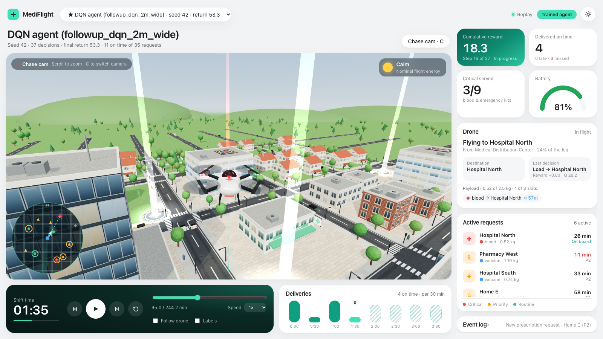

# MediFlight AI: mission-based RL for medical drone dispatch

A single drone, based at a medical distribution depot, serves 3 hospitals, 3 pharmacies and
5 homes. Requests for blood, emergency kits, vaccines, prescriptions and medicines arrive
over a 4-hour shift. Each request has a deadline, and some have a cold-chain limit. The agent
decides what to load, where to fly, when to return and when to charge. It works with a
limited battery and payload, and the weather can change during the shift.

Four TorchRL agents are trained on the same custom Gymnasium environment: **DQN**,
**REINFORCE**, **PPO** and **A2C**. They are compared with two hand-written dispatchers,
nearest-first and EDF (urgency / earliest-deadline-first with battery-feasible routing).
The comparison uses identical held-out scenarios.



## Quick start

```bash
uv sync            # Python 3.12, CPU-only PyTorch, TorchRL 0.15, Gymnasium 1.x
uv run main.py     # best trained agent: terminal decision log + 3D viewer in the browser
```

`uv run main.py` loads the best agent and plays one episode (seed 42). It prints every
decision, including the action, the policy's confidence, the reward, battery, weather and
events, and records the episode. It then serves the viewer at
`http://127.0.0.1:8001/index.html` and opens it on that recording. Press Ctrl+C to stop.

| Command | What it does |
|---|---|
| `uv run play.py --algo ppo --seed 7` | Best PPO checkpoint on scenario seed 7 |
| `uv run play.py --model models/dqn/<file>.pt` | Any saved checkpoint |
| `uv run play.py --no-viewer --delay 0.3` | Terminal only, paced for reading |
| `uv run main.py --policy edf` | Reference baseline (edf / nearest_first / random), terminal only |
| `uv run python -m visualization.export_events --policy edf nearest_first --seed 42 7` | Baseline replays for the viewer |
| `uv run pytest` | Test suite (environment contracts, physics, replay fidelity, training smoke tests, analysis pipeline) |

**How the "best agent" is chosen.** Test data is never used. For each algorithm, the
configuration with the highest mean validation return is selected (`results/best_configs.json`).
If the follow-up experiment (`evaluation/followup.py`, 2M-frame budget) produced a variant that
beat that configuration on the same validation seeds, the variant is used instead
(`results/followup_selection.json`). The algorithm with the best validation return is then
used, together with its training seed that scored highest on validation. Currently this is the
2M-frame DQN with a 2×256 network (`models/dqn/dqn_followup_dqn_2m_wide_seed2.pt`).
`--algo` overrides the algorithm, and `--main-study` ignores the follow-up and uses the
500k-frame selection.

## Environment (`environment/`)

| | |
|---|---|
| **Decision model** | Semi-MDP. Each action is a macro-action with variable duration, and time, weather and demand advance in order while it runs |
| **Actions (25, discrete)** | `0` hold 5 min · `1–11` load the pending order at a site (only at the depot) · `12–22` fly to a site (delivers on-board cargo for it) · `23` return to depot · `24` charge 10 min |
| **Action mask** | Removes only *impossible* actions (for example loading away from the depot, or exceeding payload). Risky flights stay available, so the agent must learn to manage the battery |
| **Observation (108 floats in [-1, 1])** | 20 global features: battery, time left, weather one-hot, location one-hot, payload, energy needed to reach the depot. 8 features per site: pending, on board, urgency, value, deadline slack, weight, cold-chain time left, leg energy. Full table: `environment/observation_spec.py` |
| **Reward** | + package value for on-time delivery (reduced if late) − deadline misses − spoilage − energy − invalid actions − 50 for a crash (plus the value of cargo and open orders lost) − a penalty if the shift ends away from the depot |
| **Start state** | Full battery at the depot, 4–6 initial orders, initial weather drawn from the stationary distribution |
| **Terminal states** | End of the 240-min shift (true termination) or crash / stranded battery. Truncation happens only at the 500-step safety cap |
| **Stochasticity** | Poisson demand per site, a Markov weather chain (calm / windy / storm) and wind gusts on each flight. These come from separate pre-sampled random streams, so every policy faces identical demand and weather on a given seed |

`environment/rendering.py` records an episode as JSON events and state snapshots
(schema 2.0). The viewer (`visualization/`, Three.js) rebuilds everything from that record,
so it shows exactly what the Python environment computed.

## Training (`training/`)

All four agents use TorchRL components: `Collector`, `GymWrapper`, `ActionMask`,
`QValueActor`, `DQNLoss`, `ClipPPOLoss`, `A2CLoss`, `ReinforceLoss`, `GAE`, `MaskedCategorical`
and the replay buffers.

```bash
uv run python -m training.dqn_training --config configs/dqn/exp01_baseline.toml --seed 0
uv run python -m training.pg_training  --algo ppo --config configs/ppo/exp01_baseline.toml --seed 0
uv run python -m training.sweep --seeds 0 1 2 --workers 7     # all 44 configs x 3 seeds (resumable)
```

- `configs/<algo>/exp01–exp11*.toml`: 11 configurations per algorithm (44 in total). Each is
  a baseline plus one controlled change, and exp11 is always a no-action-mask ablation.
  Unknown hyperparameter names raise an error.
- Every run trains for 500k environment frames with greedy validation every 20k frames.
  Each run writes `logs/<algo>/<config>/seed_<k>/{config.json, train.csv, eval.csv, summary.json}`.
  The best-validation checkpoint is saved to `models/{dqn,pg}/`.
- `logs/sweep_manifest.json` records the git commit, budget and exit code of every run. The
  sweep skips runs that already have a `summary.json`, so re-running it resumes after a failure.

## Evaluation protocol (`evaluation/`)

| Seed set | Seeds | Used for |
|---|---|---|
| Training | from run seed 0–4 | learning only |
| Validation | 10000–10049 | checkpoint choice during training, config selection |
| Test (held out) | 20000–20199 | final comparison only, never for any choice |

```bash
uv run python -m evaluation.compare validate     # every run x 50 validation seeds
uv run python -m evaluation.compare select       # best config per algorithm (validation only)
uv run python -m training.sweep --configs dqn/<best> ppo/<best> ... --seeds 3 4   # 5 seeds for the selected configs
uv run python -m evaluation.compare test         # selected agents + baselines on the 200 test seeds
uv run python -m evaluation.compare generalise   # shifted scenarios (first 100 test seeds)
uv run python -m evaluation.plots                # figures -> assets/figures/
uv run python -m evaluation.report_tables        # hyperparameter tables -> results/
```

- **Selection** used seeds 0–2 for all 44 configs. Seeds 3–4 were trained afterwards, only
  for the four selected configs, to make the final estimate more precise. Selection was not
  repeated after adding them.
- **Policies** are evaluated greedily (masked argmax). Baselines use a seeded tie-break RNG.
- **Confidence intervals.** Per-policy 95% CIs use the normal approximation
  `mean ± 1.96·s/√n` over the test episodes. Agent-vs-baseline comparisons are *paired*: on
  each test seed the per-episode difference is taken (agent return averaged over its training
  seeds, minus the baseline's), then 10,000 bootstrap resamples of those 200 differences give a
  percentile 95% CI. Every policy sees the same demand and weather on a given seed, which is
  what makes pairing valid.
- **Generalisation scenarios**: nominal, high demand (×1.5), low demand (×0.6), stormy (storm
  bias 0.15) and busy start (8–10 initial orders).

## Results

The measured results are in `results/`:
- `test_results.json`: per-policy test metrics with CIs, plus paired differences vs EDF and nearest-first
- `generalisation.json`, `config_tables.json`, `best_configs.json`, `hyperparameter_tables.md`
- figures in `assets/figures/`

They are summarised in the report (`report/`).

**Held-out test set** (200 seeds, 5 trained models per algorithm, 500k frames each).
The 95% CI is a normal-approximation CI over the 200 scenarios. The difference from EDF is a
paired bootstrap (10,000 resamples) on the same seeds.

| Policy | Return ± 95% CI | vs EDF [95% CI] | Critical orders on time | Crash rate |
|---|---|---|---|---|
| **DQN** | **33.88 ± 1.72** | **+12.32 [+10.42, +14.26]** | **33.2%** | 1.9% |
| PPO | 26.42 ± 1.69 | +4.86 [+2.98, +6.81] | 30.6% | 2.4% |
| A2C | 21.52 ± 2.05 | −0.03 [−2.34, +2.39] | 26.9% | 1.9% |
| REINFORCE | 20.21 ± 1.57 | −1.35 [−3.17, +0.58] | 26.4% | 0.7% |
| EDF dispatcher | 21.56 ± 2.01 | — | 23.4% | 1.5% |
| Nearest-first | 3.32 ± 2.47 | — | 8.1% | 5.5% |
| Random (valid actions) | −65.75 ± 2.00 | — | 11.5% | 97.0% |

DQN and PPO beat EDF; A2C and REINFORCE are statistically tied with it. The agents gain by
**triage**: they deliver about as many orders on time as EDF, but more of them critical (blood,
emergency kits). In return they accept about one late delivery per shift.

**Follow-up (an extension; the table above is final).** Candidates were trained for 2M frames
and selected on validation seeds only. The test set was then used once more, for the two
winners only:
- the DQN with a 2×256 network reached **39.79 ± 1.72**, +18.23 [+16.36, +20.13] vs EDF, with
  36.7% of critical orders on time;
- PPO reached 32.12 ± 1.73.

Both improved on their 500k versions by about 6 points. `uv run main.py` showcases this DQN.

## Repository layout

```
environment/   custom_env.py (Gymnasium env), entities.py (map, packages, weather, drone),
               observation_spec.py, baselines.py, rendering.py (episode recorder)
training/      common.py, dqn_training.py, pg_training.py (PPO, A2C, REINFORCE), sweep.py
configs/       44 hyperparameter configurations + 3 follow-up configurations (TOML)
evaluation/    protocol.py (seeds, metrics, CIs), compare.py, followup.py, plots.py, report_tables.py
logs/          per-run train.csv, eval.csv, config.json, summary.json
report/        final_report.pdf / .docx (submitted report, ALU template, built by fill_template.py);
               REPORT_DRAFT.md + build.py -> report.pdf / report.docx (longer working draft)
visualization/ index.html, app.js, style.css (Three.js viewer), export_events.py, episodes/
models/        dqn/, pg/: all 155 trained checkpoints (sweep + follow-up)
results/       analysis outputs (JSON / Markdown)
assets/        figures and screenshots
tests/         pytest suite
main.py, play.py
```

All checkpoints and run logs are committed (about 55 MB in total), so every number in the report
can be re-evaluated without retraining. Example: `uv run python -m evaluation.compare test`.

## Compute

All experiments ran CPU-only on an Apple M1 laptop (8 cores, 16 GB), with one thread per run and
7 runs in parallel. The networks are small MLPs (2×128) and the cost is dominated by stepping
the Python environment, so a GPU would not speed this up. All 132 sweep runs took about 2.5 hours. The 15 follow-up runs (2M frames each) took about 1 hour
per DQN run and about 20 minutes per PPO run.

## Limitations

This is a dispatch-level model, not a flight controller: there are no physical dynamics,
airspace or regulations. Demand rates, energy use and package attributes are plausible but
not calibrated to real data. There is one drone, and each site has at most one active request
at a time (further requests to a busy site are counted as rejected). Clinical outcomes are
represented only through urgency weights and deadlines.
