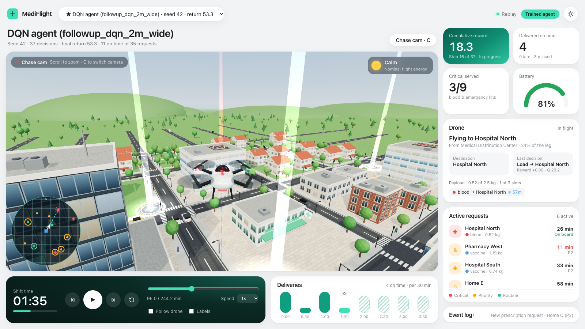
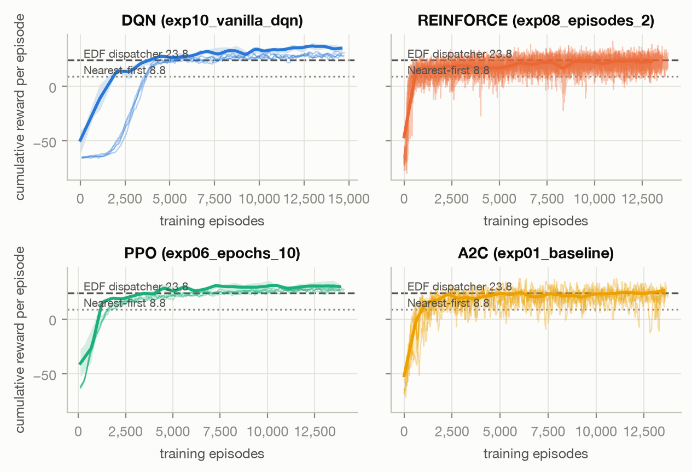
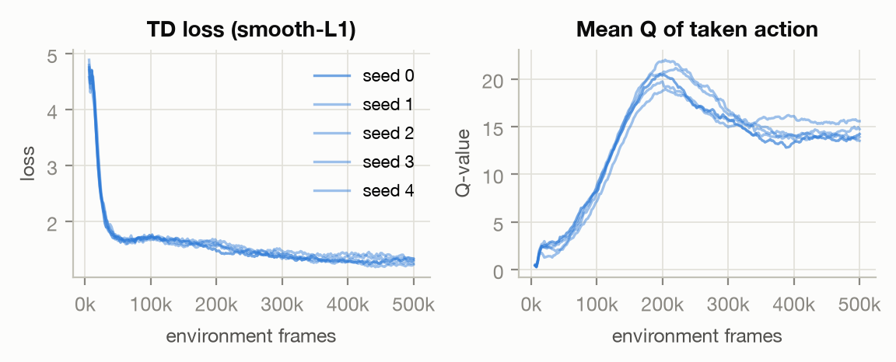
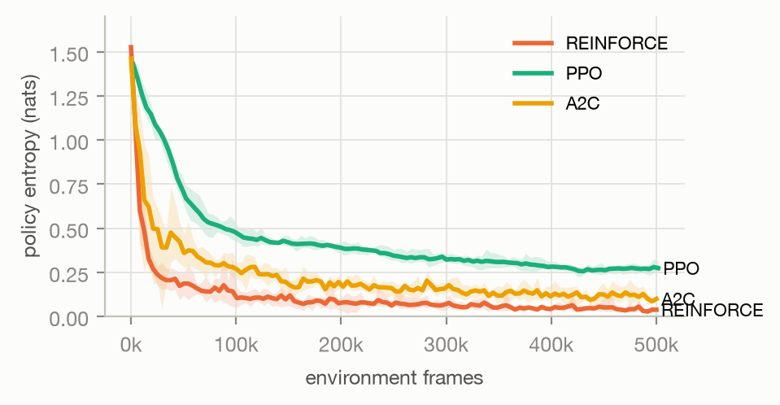
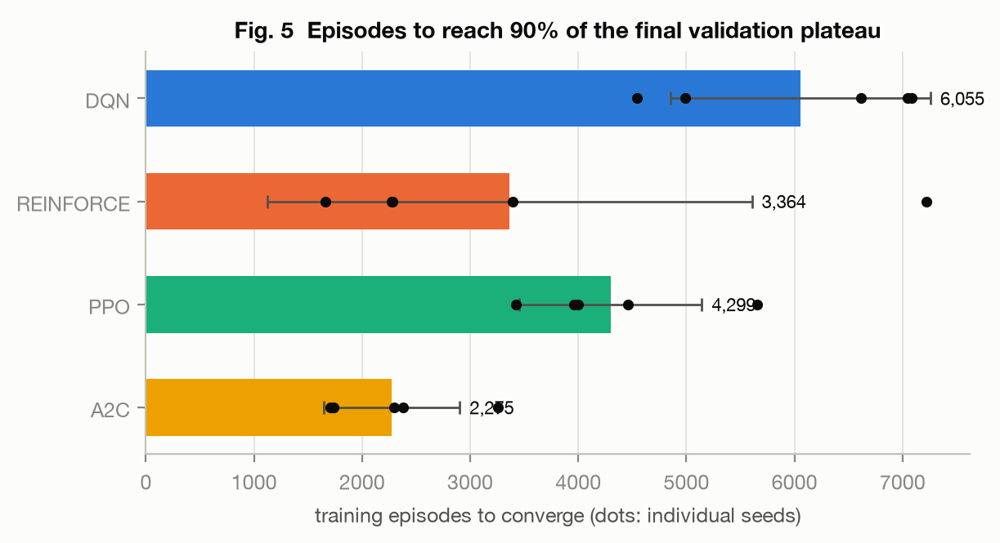
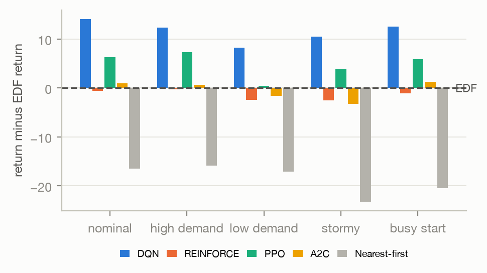

# Reinforcement Learning Summative Assignment Report

**Student Name:** Tapiwanashe Gift Marufu
**Video Recording:** https://youtu.be/m70gpbfvkCI
**GitHub Repository:** https://github.com/Tapiwanashe6/tapiwanashe_marufu_rl_summative

## 1. Project Overview

MediFlight AI trains an autonomous medical-delivery drone to dispatch blood, vaccines, emergency
kits and medicines from one distribution centre to 11 hospitals, pharmacies and homes during a
4-hour shift. Demand exceeds what one drone can serve, so it must decide what to load, where to fly and
when to charge under deadlines, cold-chain limits and changing weather. I built a custom Gymnasium
environment and trained DQN, REINFORCE, PPO and A2C (TorchRL), comparing them with dispatch heuristics on held-out scenarios.

## 2. Environment Description

### 2.1 Agent(s)

One autonomous VTOL medical drone (the agent) based at the Medical Distribution Center (node 0,
with charging pad). Capabilities: load packages at the depot, fly legs between any two of the
12 nodes (lowering the package on arrival at its destination), return to the depot, charge,
or hold. It has a 100% battery, 2.5 kg / 3-package payload limit and 60 km/h calm-air cruise
speed. Leg energy grows with distance, payload mass and wind (calm ×1.0, windy ×1.3, storm ×1.8),
plus ±6% gust noise, so flights with thin margins can fail. **Why RL:** the task is a
sequential resource-allocation problem with stochastic demand and weather, delayed rewards and
irreversible failures (crash, spoilage, expiry). Good decisions depend on the future (which
orders are likely to arrive, whether charging now leaves time for the next critical request),
which one-step ranking or shortest-path rules cannot capture; Section 5 tests this empirically
against two such rules.

### 2.2 Action Space

Discrete, 25 actions, each a real drone operation that consumes simulated time:

| Action | Meaning | Real-world mapping | Duration |
|---|---|---|---|
| 0 | Hold | Wait on pad / for weather | 5 min |
| 1–11 | Load order for site *i* | Ground crew loads package into drone bay (depot only) | 1 min |
| 12–22 | Fly to site *i* | Autonomous leg; package lowered by tether on arrival | distance / speed + 1 min |
| 23 | Return to depot | Leg back to distribution centre | distance / speed + 1 min |
| 24 | Charge | Battery top-up on depot pad (2.5 %/min) | ≤10 min |

**Action masking.** Physically impossible actions (loading away from the depot, exceeding
capacity, flying to a site whose package is not on board, charging away from the pad or when
<1% below full) are masked via an `action_mask` observation used by every algorithm
(masked Q-values / masked categorical policy). Risky-but-possible actions, such as flying with
too little battery, are *not* masked: the agent must learn energy management. An ablation per
algorithm disables masking and penalises invalid actions instead.

### 2.3 Observation Space

| Observation | Description | Source (Sensor/Camera/API/Dataset) | Encoding / Data Type | Range | Update cadence | Simulator rule |
|---|---|---|---|---|---|---|
| battery | State of charge of the drone battery | Sensor: battery management system | float32, battery / capacity | [0, 1] | every decision step | 100% at start; minus leg energy, plus charging |
| time_remaining | Fraction of the mission shift remaining | System: mission clock | float32 | [0, 1] | every decision step | 1 - t / horizon |
| weather | Current weather (calm, windy, storm) | API: weather service / onboard anemometer | one-hot (3) | {0, 1} | every 10 sim-minutes | 3-state Markov chain advanced every 10 simulated minutes |
| location | Current node: depot or one of 11 sites | Sensor: GNSS position snapped to node | one-hot (12) | {0, 1} | every decision step | set on arrival of each flight leg |
| payload_weight | Mass currently carried | Sensor: payload load cell | float32, kg / payload capacity | [0, 1] | every decision step | sum of weights of loaded packages |
| payload_count | Number of packages on board | System: cargo manifest | float32, count / max packages | [0, 1] | every decision step | count of loaded packages |
| energy_to_depot | Expected energy to fly home now | Derived: map + weather + payload | float32, % / capacity, clipped | [0, 1] | every decision step | leg energy model, current weather and payload |
| site.pending (x11) | An order for this site is waiting at the depot | API: hospital/pharmacy/patient order system | binary | {0, 1} | every decision step | Poisson arrivals, max 1 active order per site |
| site.on_board (x11) | This site's package is loaded on the drone | System: cargo manifest | binary | {0, 1} | every decision step | set by a load action, cleared on delivery/spoilage |
| site.urgency (x11) | Clinical urgency of the active order | API: order system (triage level) | float32, level / 3 (0 if none) | [0, 1] | on order arrival | fixed by package type |
| site.value (x11) | Clinical value of delivering the order on time | API: order system | float32, value / max value (0 if none) | [0, 1] | on order arrival | fixed by package type |
| site.deadline_slack (x11) | Minutes left until the deadline | API: order system (requested delivery time) | float32, minutes / 120, clipped | [-1, 1] | every decision step | deadline - t |
| site.weight (x11) | Package mass | Dataset: dispatch manifest | float32, kg / payload capacity (0 if none) | [0, 1] | on order arrival | uniform within package-type range |
| site.cold_chain_left (x11) | Minutes of cold-chain life left (blood, vaccine) | Sensor: cold-box temperature logger | float32, minutes / 90 (0 if not cold-chain) | [0, 1] | every decision step | limit - minutes on board; 1.0 if not yet loaded |
| site.leg_energy (x11) | Expected energy to fly from current node to this site | Derived: map + weather + payload | float32, % / capacity, clipped | [0, 1] | every decision step | leg energy model, current weather and payload |

Total: 108 float32 values = 20 global + 11 sites x 8. Agent-input path: Gymnasium Dict observation key `observation` -> TorchRL GymWrapper -> MLP input; key `action_mask` -> masked Q-values / MaskedCategorical.

Package types (sampled per destination kind; deadlines measured from request time):

| Package | Urgency | Value | Weight (kg) | Deadline (min) | Cold chain (min on board) |
|---|---|---|---|---|---|
| blood | 3 | 10 | 0.5–1.2 | 40–60 | 60.0 |
| emergency_kit | 3 | 9 | 0.8–1.6 | 35–50 | — |
| vaccine | 2 | 6 | 0.6–1.5 | 90–120 | 90.0 |
| prescription | 2 | 4 | 0.2–0.8 | 60–120 | — |
| medicine | 1 | 3 | 0.8–2.0 | 120–180 | — |

**Start state:** t = 0, drone at depot, 100% battery, empty payload, 4–6 initial orders,
weather drawn from the chain's stationary distribution (calm 47%, windy 41%, storm 12%).
**Terminal conditions:** (i) end of the 240-min shift (a true terminal state, since remaining
time is observed); (ii) mission failure: battery exhausted in flight (crash) or while parked
at a site (stranded). A 500-decision cap is the only truncation and never triggers in practice.
**Stochasticity and fairness:** order requests and the weather path are pre-sampled per seed
from streams independent of the agent's actions, so on a given seed every policy faces
identical demand and weather (common random numbers).

### 2.4 Reward Structure

Per decision step *t*:

r_t = Σ_on-time v_k + 0.25 Σ_late v_k − 0.5 Σ_deadline-passed v_k − Σ_spoiled v_k
      − 0.02 E_t − 1[invalid] − 1[failure]·(50 + Σ_on-board v_k + 0.5 Σ_active v_k)
      − 0.5 Σ_on-board-at-shift-end v_k − 5·1[shift ends away from depot]

where v_k is the package value (blood 10, emergency kit 9, vaccine 6, prescription 4,
medicine 3) and E_t the battery % used during the step. Design choices: (a) positive reward
comes *only* from deliveries, so loading/unloading or hovering cannot be farmed; (b) a late
delivery nets −0.25 v versus −0.5 v for never delivering ("late is better than never");
(c) mission failure also charges every unserved order, otherwise crashing early would stop
further deadline penalties and could look attractive (we observed this in a prototype);
(d) the energy term discourages wasted flights without dominating clinical value.

### 2.5 Environment Visualization

**Integration path.** `play.py` loads the selected checkpoint and runs it in the real Gymnasium
environment with a greedy, masked policy. It prints every decision to the terminal. The run is
recorded by `EpisodeRecorder` (`environment/rendering.py`) as versioned JSON (schema 2.0): an
`episode_start` record with the map and initial state, then one `step` record per decision
containing the action, reward, timestamped domain events (order created, take-off, delivery,
deadline missed, weather change, charge), the resulting state and the policy's Q-value or
probability, then an `episode_end` summary. Only the file sink is implemented, so the viewer is
replay-only (the sink interface would also allow a live Server-Sent Events stream, which was not built). A Three.js viewer (`visualization/`) replays this
stream in a 3D town: the depot with its charging pad, hospitals with rooftop helipads,
pharmacies and homes, weather (clouds, rain and lightning in storms), four cameras, a radar
minimap, and panels for reward, battery, payload, the last decision and active requests. The
viewer has no simulation logic, so it shows exactly what the environment computed.
`uv run main.py` runs the whole path.

**Observed behaviour (demo seed 42, not a test seed).** The selected DQN delivered 11 of 35
requests on time, none late, for a return of 53.3. Seven of the 11 deliveries were critical
(blood or emergency kits). It flew 7 sorties, most pairing a hospital with a nearby home in one
trip. It recharged at the depot after almost every sortie and landed back at the depot at
minute 244 with 8% battery (its last decision began at minute 235.6; an action started before the
240-minute horizon is always completed), so it never risked a crash. One questionable habit is visible: it
sometimes loads a package and then charges before leaving, which uses deadline slack.

## 3. System Analysis and Design

All agents use TorchRL 0.15 on `GymWrapper(MediFlightEnv)` with identical transforms
(bool action mask, episode-reward and step counters), the same 108→128→128 tanh MLP torso,
Adam, gradient-norm clipping, and the same 500k-frame budget. Evaluation is deterministic
(masked argmax) on held-out seeds.

### 3.1 Deep Q-Network (DQN)

`QValueActor` maps the observation to 25 Q-values; invalid actions are set to the dtype minimum
before the argmax, both when acting and inside the bootstrap target. Exploration: TorchRL
`EGreedyModule` with linearly annealed ε (random actions drawn from the masked spec) after
5k uniform warm-up frames. Experience is stored in a `TensorDictReplayBuffer` (uniform
sampling), collected 16 frames at a time with 4 gradient steps per round. Loss: `DQNLoss` with
smooth-L1 TD error and a hard target-network copy every 1000 gradient steps (soft Polyak updates
in one experiment). The reference configuration uses a **Double DQN** target (online network
selects a′, target network evaluates it); the selected configuration (exp10) turns it off and
uses the vanilla max-Q target.

### 3.2 Policy Gradient Methods (REINFORCE, PPO, A2C)

Shared policy: `ProbabilisticActor` producing logits over 25 actions with a `MaskedCategorical`
distribution (zero probability on invalid actions); value head `ValueOperator` (same torso).

* **REINFORCE:** complete episodes via `env.rollout`, Monte-Carlo returns G_t, loss
  −log π(a_t|s_t)·Â_t through TorchRL `ReinforceLoss`; Â_t = normalised G_t, or G_t − V(s_t) with
  a learned baseline in one experiment; optional entropy bonus.
* **PPO:** `Collector` rollouts (2048 frames in total per update: 4 envs × 512 steps), GAE(λ=0.95) advantages, clipped surrogate
  `ClipPPOLoss` (ε=0.2), value and entropy terms, 4 epochs of 256-sample minibatches.
* **A2C (4.4):** synchronous 8-env × 8-step rollouts, GAE(λ=1: discounted rewards to the end of the
  8-step rollout plus the critic's bootstrap value there), single gradient step per rollout with `A2CLoss`.

## 4. Implementation

**Protocol.** Each algorithm was trained with a reference configuration (row 01) and 9 one-factor
variations of it (rows 02–10), plus a no-mask ablation (row 11). Every configuration had a budget of 500,000
environment frames and was trained with 3 seeds (0–2). During training, the greedy policy was
evaluated every 20k frames on the first 20 validation seeds, and the best checkpoint was kept.
**Mean Reward** is the return of that checkpoint on all 50 validation seeds (10000–10049),
shown as the mean ± standard deviation across the 3 training seeds. **Crit.** is the fraction
of critical orders (blood, emergency kits) delivered on time. The configuration with the
highest mean validation return was selected (bold). No test seed was used for any of these
choices. Settings not listed are shared: γ = 0.99 unless shown, a 2×128 tanh MLP, Adam and
gradient-norm clipping at 1.0. On the same validation seeds, the EDF dispatcher scores 23.8 and
nearest-first scores 8.8.

### 4.1 DQN

| # | Learning Rate | Gamma | Replay Buffer Size | Batch Size | Exploration Strategy | Target update | Mean Reward | Crit. |
|---|---|---|---|---|---|---|---|---|
| 01 | 5e-4 | 0.99 | 100,000 | 128 | ε 1→0.05 over 100k frames | hard /1000, Double | 35.11 ± 2.47 | 0.342 |
| 02 | 1e-4 | 0.99 | 100,000 | 128 | ε 1→0.05 over 100k | hard /1000, Double | 27.16 ± 1.92 | 0.312 |
| 03 | 2e-3 | 0.99 | 100,000 | 128 | ε 1→0.05 over 100k | hard /1000, Double | 32.19 ± 2.99 | 0.335 |
| 04 | 5e-4 | 0.95 | 100,000 | 128 | ε 1→0.05 over 100k | hard /1000, Double | 34.23 ± 1.82 | 0.351 |
| 05 | 5e-4 | 0.99 | 10,000 | 128 | ε 1→0.05 over 100k | hard /1000, Double | 34.17 ± 3.14 | 0.345 |
| 06 | 5e-4 | 0.99 | 100,000 | 32 | ε 1→0.05 over 100k | hard /1000, Double | 31.03 ± 1.88 | 0.314 |
| 07 | 5e-4 | 0.99 | 100,000 | 128 | ε 1→0.01 over 25k | hard /1000, Double | 32.74 ± 2.24 | 0.353 |
| 08 | 5e-4 | 0.99 | 100,000 | 128 | ε 1→0.1 over 250k | hard /1000, Double | 36.12 ± 0.88 | 0.348 |
| 09 | 5e-4 | 0.99 | 100,000 | 128 | ε 1→0.05 over 100k | soft τ = 0.005, Double | 33.60 ± 1.56 | 0.333 |
| **10** | 5e-4 | 0.99 | 100,000 | 128 | ε 1→0.05 over 100k | hard /1000, **vanilla** | **36.76 ± 0.49** | 0.349 |
| 11 | 5e-4 | 0.99 | 100,000 | 128 | ε 1→0.05 over 100k | as 01, **no action mask** | 19.71 ± 4.24 | 0.291 |

**Observations.** The learning rate mattered most: 1e-4 was clearly too slow (27.2), and 2e-3
was noisier (32.2 ± 3.0). Batch size 32 lost about 4 points. Slower exploration (row 08) and
the vanilla target (row 10) were best, but their difference (0.6) is smaller than the
seed-to-seed spread, so the selection between them is weak. The vanilla target did not hurt,
which suggests Q-value overestimation is not the limiting factor here. Without the mask,
DQN still learned a usable policy (19.7), but it was worse and less stable. It made about 2.9
invalid actions per episode at evaluation time.

### 4.2 REINFORCE

| # | Learning Rate | Gamma | Episodes / update | Baseline | Return norm. | Entropy coef. | Mean Reward | Crit. |
|---|---|---|---|---|---|---|---|---|
| 01 | 1e-3 | 0.99 | 8 | none | yes | 0 | 22.01 ± 3.82 | 0.274 |
| 02 | 3e-4 | 0.99 | 8 | none | yes | 0 | 18.58 ± 0.31 | 0.254 |
| 03 | 3e-3 | 0.99 | 8 | none | yes | 0 | 22.35 ± 3.54 | 0.287 |
| 04 | 1e-3 | 0.95 | 8 | none | yes | 0 | 22.53 ± 4.48 | 0.285 |
| 05 | 1e-3 | 0.999 | 8 | none | yes | 0 | 22.10 ± 3.65 | 0.280 |
| 06 | 1e-3 | 0.99 | 8 | learned V(s) | yes | 0 | 18.25 ± 1.12 | 0.256 |
| 07 | 1e-3 | 0.99 | 8 | none | no | 0 | 18.97 ± 1.57 | 0.259 |
| **08** | 1e-3 | 0.99 | **2** | none | yes | 0 | **22.77 ± 4.04** | 0.285 |
| 09 | 1e-3 | 0.99 | 32 | none | yes | 0 | 19.02 ± 0.80 | 0.242 |
| 10 | 1e-3 | 0.99 | 8 | none | yes | 0.01 | 19.12 ± 3.14 | 0.263 |
| 11 | 1e-3 | 0.99 | 8 | none | yes | 0 | −46.32 ± 0.00 | 0.000 (no mask) |

**Observations.** All REINFORCE configurations landed in a narrow band (18–23), with large
spread across seeds (± 3–4). The selected configuration (2 episodes per update) is not
meaningfully better than the reference. Changes that reduce variance, namely a learned
baseline (row 06), 32 episodes per update (row 09) and an entropy bonus (row 10), made returns
more consistent but *lower*. More frequent, noisier updates helped more than cleaner but rarer
ones within a fixed frame budget. Without the mask, every seed collapsed to the same
degenerate policy: **hold for the whole shift**. I checked this by rolling it out: all 48
decisions were "Hold". Hold is the only action that is always valid, so it never pays the
−1 invalid-action penalty, never crashes, and only incurs deadline penalties (−46.3).

### 4.3 PPO

| # | Learning Rate | Clip ε | Epochs | GAE λ | Entropy coef. | Rollout / minibatch | Mean Reward | Crit. |
|---|---|---|---|---|---|---|---|---|
| 01 | 3e-4 | 0.2 | 4 | 0.95 | 0.01 | 2048 / 256 | 24.35 ± 3.07 | 0.289 |
| 02 | 1e-4 | 0.2 | 4 | 0.95 | 0.01 | 2048 / 256 | 18.98 ± 1.97 | 0.257 |
| 03 | 1e-3 | 0.2 | 4 | 0.95 | 0.01 | 2048 / 256 | 28.04 ± 1.29 | 0.323 |
| 04 | 3e-4 | 0.1 | 4 | 0.95 | 0.01 | 2048 / 256 | 28.12 ± 1.49 | 0.319 |
| 05 | 3e-4 | 0.3 | 4 | 0.95 | 0.01 | 2048 / 256 | 24.57 ± 1.23 | 0.292 |
| **06** | 3e-4 | 0.2 | **10** | 0.95 | 0.01 | 2048 / 256 | **30.95 ± 1.23** | 0.339 |
| 07 | 3e-4 | 0.2 | 4 | 0.80 | 0.01 | 2048 / 256 | 26.31 ± 2.70 | 0.311 |
| 08 | 3e-4 | 0.2 | 4 | 0.95 | 0 | 2048 / 256 | 23.58 ± 0.69 | 0.273 |
| 09 | 3e-4 | 0.2 | 4 | 0.95 | 0.05 | 2048 / 256 | 28.58 ± 0.64 | 0.335 |
| 10 | 3e-4 | 0.2 | 4 | 0.95 | 0.01 | 512 / 128 | 24.56 ± 2.90 | 0.288 |
| 11 | 3e-4 | 0.2 | 4 | 0.95 | 0.01 | 2048 / 256, no mask | −15.03 ± 21.68 | 0.172 |

**Observations.** PPO was the most sensitive to its hyperparameters (19.0 to 31.0). Every
change that extracts more learning from each rollout helped: 10 epochs (+6.6), a 1e-3
learning rate (+3.7), and a tighter clip of ε = 0.1 (+3.8, because it allowed stable reuse).
A stronger entropy bonus (0.05) also helped (+4.2), which matches PPO keeping the highest
policy entropy (Fig. 4). Within 500k frames, the reference configuration was under-trained
rather than unstable. Without the mask, the result depended heavily on the seed (−15.0 ± 21.7): one seed
learned a weak working policy (+7.3), and the other two served only 6–8% of requests
(−16.3 and −36.1).

### 4.4 A2C (Actor-Critic)

| # | Learning Rate | Rollout (envs × steps) | GAE λ | Entropy coef. | Critic coef. | Adv. norm. | Mean Reward | Crit. |
|---|---|---|---|---|---|---|---|---|
| **01** | 7e-4 | 8 × 8 | 1.0 | 0.01 | 0.5 | no | **25.21 ± 0.52** | 0.289 |
| 02 | 2e-4 | 8 × 8 | 1.0 | 0.01 | 0.5 | no | 25.03 ± 0.73 | 0.297 |
| 03 | 2e-3 | 8 × 8 | 1.0 | 0.01 | 0.5 | no | 23.55 ± 1.54 | 0.292 |
| 04 | 7e-4 | 8 × 8 | 0.95 | 0.01 | 0.5 | no | 24.53 ± 1.76 | 0.296 |
| 05 | 7e-4 | 8 × 8 | 0 (1-step TD) | 0.01 | 0.5 | no | 16.00 ± 2.14 | 0.244 |
| 06 | 7e-4 | 8 × 32 | 1.0 | 0.01 | 0.5 | no | 21.11 ± 3.78 | 0.262 |
| 07 | 7e-4 | 8 × 8 | 1.0 | 0 | 0.5 | no | 24.82 ± 1.18 | 0.292 |
| 08 | 7e-4 | 8 × 8 | 1.0 | 0.05 | 0.5 | no | 23.32 ± 1.19 | 0.292 |
| 09 | 7e-4 | 8 × 8 | 1.0 | 0.01 | 0.25 | no | 24.44 ± 1.12 | 0.296 |
| 10 | 7e-4 | 8 × 8 | 1.0 | 0.01 | 0.5 | yes | 24.40 ± 0.70 | 0.293 |
| 11 | 7e-4 | 8 × 8, no mask | 1.0 | 0.01 | 0.5 | no | −46.32 ± 0.00 | 0.000 |

**Observations.** A2C was the least sensitive algorithm: 7 of its 9 variations fell within 2
points of the reference, and the reference itself was selected. The one large effect was
bootstrapping. One-step TD advantages (λ = 0) lost 9 points: they rely entirely on a critic that
is still inaccurate, while λ = 1 uses up to 8 real rewards before bootstrapping. Longer rollouts
(8 × 32) cost 4 points: with one update per rollout, 500k frames allow about 1,950 updates instead of 7,800. Without the
mask, A2C collapsed to the same always-hold policy as REINFORCE.

## 5. Results Discussion

**How the results were produced.** The training, validation and test sets are disjoint:

- **Training** environments are seeded from the run seed and follow their own RNG chain.
- **Model selection** (§4, and choosing checkpoints during training) used only the 50
  **validation** seeds (10000–10049).
- The selected configuration of each algorithm was then trained with 2 more seeds (3–4).
  The 5 resulting models were evaluated **once** on 200 held-out **test** seeds
  (20000–20199), together with the baselines.
- Because order arrivals and the weather path are pre-sampled from each seed (common random
  numbers), every policy faces identical scenarios, so comparisons can be paired.

**How the confidence intervals were calculated.**

- **Per-policy 95% CI.** For each test seed, the agent's return is first averaged over its 5
  trained models. The interval is then a normal-approximation CI over the 200 scenarios:
  mean ± 1.96·s/√200. Training-seed variability is reported separately, as the standard
  deviation of the 5 models' mean returns.
- **Agent vs EDF.** Comparisons use a **paired bootstrap**: 10,000 resamples of the 200
  per-seed differences, with the 2.5th–97.5th percentile interval reported. "Wins" is the
  fraction of seeds on which the agent's return was higher.
- **No winner from training curves.** No conclusion below rests on the best training episode
  or on training curves.

### 5.1 Cumulative Rewards

**Training.** Fig. 2 shows the cumulative reward of each training episode (thin lines) and of the greedy
policy on validation seeds (thick lines) against training episodes, for each method's best
configuration. All four algorithms climb from about −50 to −65 (a random-like policy that
crashes or lets orders expire) to above the nearest-first baseline. How quickly each converges is measured with one definition in
§5.2 (A2C fastest, then REINFORCE, PPO and DQN).

- DQN's *training* return stays below its validation return throughout. Training episodes
  include ε-greedy exploration (ε ≥ 0.05), so the greedy policy is better than the behaviour
  that generated the data.
- REINFORCE and A2C have visibly noisier training curves. This is expected from Monte-Carlo
  returns from single episodes.

**Validation (selection set).** Each selected configuration, scored as the mean over 5 trained
models on 50 validation seeds:

| | DQN | PPO | A2C | REINFORCE | EDF | Nearest-first |
|---|---|---|---|---|---|---|
| Mean return | 35.75 ± 2.05 | 30.83 ± 1.07 | 25.28 ± 0.93 | 23.08 ± 2.91 | 23.78 | 8.79 |

These numbers were used for selection and are therefore optimistic. The test results below are
the unbiased estimate.

**Test (held-out, 200 seeds).**

| Policy | Return ± 95% CI | Paired diff. vs EDF [95% CI] | Wins vs EDF | On-time deliveries | Late | Critical on time | Crash rate |
|---|---|---|---|---|---|---|---|
| **DQN** | **33.88 ± 1.72** | **+12.32 [+10.42, +14.26]** | 84.5% | 9.77 | 1.04 | **33.2%** | 1.9% |
| PPO | 26.42 ± 1.69 | +4.86 [+2.98, +6.81] | 66.5% | 9.03 | 0.68 | 30.6% | 2.4% |
| A2C | 21.52 ± 2.05 | −0.03 [−2.34, +2.39] | 51.5% | 8.71 | 0.86 | 26.9% | 1.9% |
| REINFORCE | 20.21 ± 1.57 | −1.35 [−3.17, +0.58] | 39.0% | 8.49 | 0.73 | 26.4% | 0.7% |
| EDF dispatcher | 21.56 ± 2.01 | — | — | 9.88 | 0.01 | 23.4% | 1.5% |
| Nearest-first | 3.32 ± 2.47 | — | — | 10.67 | 0.30 | 8.1% | 5.5% |
| Random (masked) | −65.75 ± 2.00 | — | — | 3.20 | 0.46 | 11.5% | 97.0% |

*Training-seed spread of the test return (SD of the 5 models):* DQN 0.75, PPO 1.43, A2C 0.76,
REINFORCE 2.23.

**Main findings.**

1. **DQN performed best.** It beat EDF by +12.3 points (95% CI [+10.4, +14.3]) and won on 84.5%
   of test scenarios. PPO also beat EDF clearly (+4.9 [+3.0, +6.8]).
2. **A2C and REINFORCE are statistically indistinguishable from EDF.** Both CIs contain 0.
   They learned roughly the hand-written rule, but no better.
3. **The agents win by triage, not by doing more.** DQN delivered slightly *fewer* orders on
   time than EDF (9.77 vs 9.88), and nearest-first delivered the most (10.67), yet its return
   was the second lowest. DQN's advantage comes from *which* orders it serves. Its on-time
   critical service rate was 33.2% against EDF's 23.4%, a paired difference of +9.8 percentage
   points [+8.6, +11.1]. Blood and emergency kits are worth 9–10 reward units, against 3 for
   medicine.
4. **The trade-off is lateness.** DQN delivers about one order late per shift (1.04 vs EDF's
   0.01). It has learned that a late critical delivery (+0.25 v) is worth more than serving a
   low-value order on time.

### Training Stability

**DQN.** The smooth-L1 TD loss falls from about 4.8 to 1.7 within 40k frames and then declines
slowly to about 1.3 (Fig. 3).

- The mean Q-value of the chosen action rises to about 20 at 200k frames, then falls back and
  settles at 14–15.
- This overshoot coincides with the end of ε-annealing (100k frames) and the larger returns
  the greedy policy starts to collect. It is followed by a correction as the target network
  catches up. It did not cause divergence on any seed, and all five curves are nearly
  identical.
- DQN was also the most stable algorithm *across training seeds*: its 5 test returns were
  32.6–34.5 (SD 0.75).

**Policy-gradient methods.** Policy entropy (Fig. 4) shows how quickly each policy became
deterministic.

| Algorithm | Entropy (nats) | Behaviour | Test returns across seeds |
|---|---|---|---|
| REINFORCE | 1.5 → ≈0.2 by 50k → 0.04 | Commits to a near-deterministic policy very early, without a critic to correct it | Widest spread: 17.1–22.4 (SD 2.23) |
| A2C | → ≈0.1 | Its critic stabilises training | Tight spread: SD 0.76 |
| PPO | Highest throughout, ≈0.28 at 500k | The clipped objective limits how far each update moves the policy; still improving when the budget ran out | Spread: SD 1.43 |

### 5.2 Episodes to Converge

Convergence is defined as the first evaluation point at which the 3-point moving average of
the validation return reaches 90% of the way from its initial value to its final plateau. The
plateau is the mean of the last 5 evaluations.

| | A2C | REINFORCE | PPO | DQN |
|---|---|---|---|---|
| Training episodes (mean ± SD over 5 seeds) | 2,275 ± 630 | 3,364 ± 2,243 | 4,299 ± 844 | 6,055 ± 1,203 |
| Environment frames | 80k | 120k | 153k | 180k |

- **A2C converged fastest but to the lowest plateau.** REINFORCE's convergence point varied
  the most (1,662–7,218 episodes).
- **DQN was the slowest but reached the highest plateau.** It spends its first 100k frames
  mostly exploring.
- Because this measures convergence to *each algorithm's own* plateau, "fast" is not "good":
  the fast-converging methods reached a lower level.

### 5.3 Generalization

Every test seed is an unseen initial state: a different set of initial orders, starting weather,
and future demand and weather path. The test results in §5.1 are therefore already a measure
of generalisation to unseen initial states. To stress this further, the selected models were
run, unchanged, on the first 100 test seeds under four shifted conditions never seen in
training, including a busier initial state (8–10 initial orders instead of 4–6). The table shows mean return, averaged over the 5
models per algorithm, with the 95% CI over the 100 scenarios:

| Scenario | Change | DQN | PPO | A2C | REINFORCE | EDF | Nearest-first |
|---|---|---|---|---|---|---|---|
| Nominal | — | **34.7 ± 3.5** | 26.8 ± 3.3 | 21.5 ± 3.3 | 20.0 ± 3.0 | 20.6 ± 2.8 | 4.1 ± 3.2 |
| High demand | arrivals ×1.5 | **27.9 ± 4.2** | 22.9 ± 3.8 | 16.2 ± 3.6 | 15.2 ± 3.4 | 15.6 ± 2.6 | −0.3 ± 2.8 |
| Low demand | arrivals ×0.6 | **40.0 ± 3.2** | 32.2 ± 3.0 | 30.2 ± 2.9 | 29.3 ± 2.5 | 31.8 ± 2.5 | 14.6 ± 3.3 |
| Stormy | storm bias +0.15 | **27.0 ± 3.5** | 20.3 ± 3.2 | 13.2 ± 3.8 | 13.9 ± 3.0 | 16.5 ± 2.5 | −6.7 ± 4.7 |
| Busy start | 8–10 initial orders | **32.9 ± 3.6** | 26.1 ± 3.0 | 21.6 ± 2.9 | 19.2 ± 2.8 | 20.3 ± 2.5 | −0.2 ± 3.9 |

- **DQN kept a clear lead over EDF in every condition**, by 8.2 to 14.1 points. The intervals
  never overlap. Its crash rate stayed at 0.8–2.6%.
- **PPO's lead was not robust.** Its mean was above EDF in every scenario, but the
  advantage disappeared under low demand (32.2 vs 31.8) and under storms the intervals
  overlap (20.3 vs 16.5).
- **A2C and REINFORCE fell *below* EDF under storms** (13.2 and 13.9 vs 16.5). Their policies
  are not robust to a regime where energy costs ×1.8. Nearest-first crashed in 13% of stormy
  shifts.
- **Every policy's return dropped under high demand and storms.** These conditions make the
  task harder in absolute terms, so the ranking matters more than the level.

### 5.4 Follow-up experiment: a larger training budget

Clear extension, run after the main study. The main results above are final and unchanged.
The validation curves of DQN and PPO were still rising at 500k frames, so I tested whether the
budget was limiting performance:

- **Candidates:** DQN exp10 at 2M frames; DQN exp10 at 2M frames with a 2×256 network; PPO
  exp06 at 2M frames. Each was trained with 5 seeds.
- **Selection:** candidates were compared with the original 500k models **on the validation
  seeds only**. Validation return: DQN 35.75 → 41.03 (2M) → **42.98** (2M, 2×256); PPO
  30.83 → **34.63**.
- **Testing:** only the two validation winners were evaluated on the test seeds. This was the
  second and final use of the test set.

| Policy (2M frames) | Test return ± 95% CI | vs EDF [95% CI] | vs same algorithm at 500k [95% CI] | Critical on time | Late / shift |
|---|---|---|---|---|---|
| DQN, 2×256 | **39.79 ± 1.72** | **+18.23 [+16.36, +20.13]** | +5.92 [+4.62, +7.19] | 36.7% | 0.52 |
| PPO | 32.12 ± 1.73 | +10.56 [+8.62, +12.56] | +5.71 [+4.44, +6.98] | 33.4% | 0.74 |

**Interpretation.**

- Four times the budget improved both algorithms by almost 6 points, with paired CIs well
  above zero.
- DQN halved its late deliveries and now beats EDF on 93% of test scenarios.
- The best checkpoints came at 1.2–1.98M frames, so even 2M frames may not be the ceiling.
- The 2×256 network's edge over 2×128 at 2M frames (43.0 vs 41.0 on validation) is within
  seed noise.

The demonstration agent in `main.py` and the video is this follow-up DQN. It was selected on
validation data only: the training seed with the highest validation return (seed 2).

## 6. Conclusion and Discussion

**Which method worked best.** Under an equal 500k-frame budget, **DQN** was the strongest
method on held-out scenarios:

- test return 33.9 ± 1.7 against 21.6 for the EDF dispatcher
- +12.3 [+10.4, +14.3] paired
- the most consistent across training seeds
- the only method whose advantage over EDF held clearly in every shifted condition

PPO was second: +4.9 over EDF, with a lead that did not hold clearly in every shifted
condition. A2C and REINFORCE matched EDF but did not beat it.

**Why DQN did best here.**

1. **Off-policy replay.** The environment has short episodes of about 40 decisions, a
   discrete action set and dense reward at deliveries. Off-policy replay lets DQN reuse every
   transition many times: it took about 124k gradient steps in 500k frames. The on-policy
   methods discard each batch after one or a few passes. This matters most when frames are
   the constrained resource.
2. **Sample reuse explains the PPO and DQN results.** The PPO variations that improved most
   were those that increased reuse (10 epochs, a higher learning rate).
3. **The follow-up confirms both were budget-limited.** At 2M frames both improved by about
   6 points, and DQN's lead over EDF grew to +18.2.
4. **REINFORCE suffers from high-variance Monte-Carlo gradients.** Its policy became nearly
   deterministic within 50k frames (entropy 0.04), which locks in early mistakes. Its
   variance-reduction variants (baseline, larger batches) learned more slowly within the
   budget.
5. **A2C's critic made it stable but conservative.** It converged fastest (2.3k episodes),
   but onto an EDF-like plateau.

**Strengths.**

- The learned policies discover **clinical triage** that neither heuristic encodes: they skip
  low-value orders so that blood and emergency kits arrive in time. Critical on-time service
  rose from 23% (EDF) to 33% (DQN at 500k) and 37% (DQN at 2M) with the same drone and the
  same demand.
- Action masking was essential. Without it, two of the four algorithms collapsed to a
  degenerate "always hold" policy, and PPO became unreliable across seeds.

**Weaknesses (seen in the data and the replays).**

1. **Lateness.** The agents accept more late deliveries than EDF (about 1 per shift for DQN at
   500k, 0.5 at 2M, 0.01 for EDF). That is rational under the reward (+0.25 v late) but may
   be unacceptable clinically.
2. **A reward loophole at the end of the shift.** Only cargo *on board* at shift end is
   penalised; pending orders at the depot are not, so the last minutes carry little reward signal.
   On demo seed 42 the 500k DQN loaded a blood order (deadline minute 269) at minute 233.7 and then
   charged, taking −5 where a 9-minute flight would have earned about +10: not a profitable exploit,
   but a mistake the reward makes cheap.
3. **The agents optimise the same reward they are evaluated on.** The improvement over EDF is
   partly an improvement on *this* reward's weighting of urgency against lateness. EDF
   optimises a different criterion (meeting deadlines).
4. **The system is overloaded by design.** Every policy serves only about 26% of requests on
   time, because one drone cannot meet the demand. The absolute service rate reflects the
   scenario, not the agent.

**Future improvements.**

- **Fix the end-of-shift reward:** penalise pending orders at the depot at shift end, or use
  a rolling-horizon termination, so behaviour near the end of the shift is no longer
  distorted.
- **Expose clinical constraints explicitly:** add a hard cap or a steeper penalty on
  lateness for critical orders, then check that triage still emerges.
- **Train longer, now that DQN and PPO are known to be budget-limited:** use prioritised
  replay or dueling heads for DQN, then multi-drone dispatch with a shared policy.
- **Use domain randomisation over demand and weather during training,** which should close
  the gap seen under storms.

Limitations of this study: 500k-frame training on CPU, 3 seeds per configuration in the sweep
(5 for selected configurations), and one-factor-at-a-time tuning, which cannot detect
interactions between hyperparameters.
